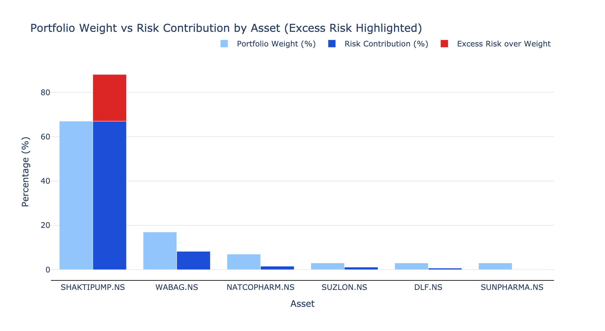
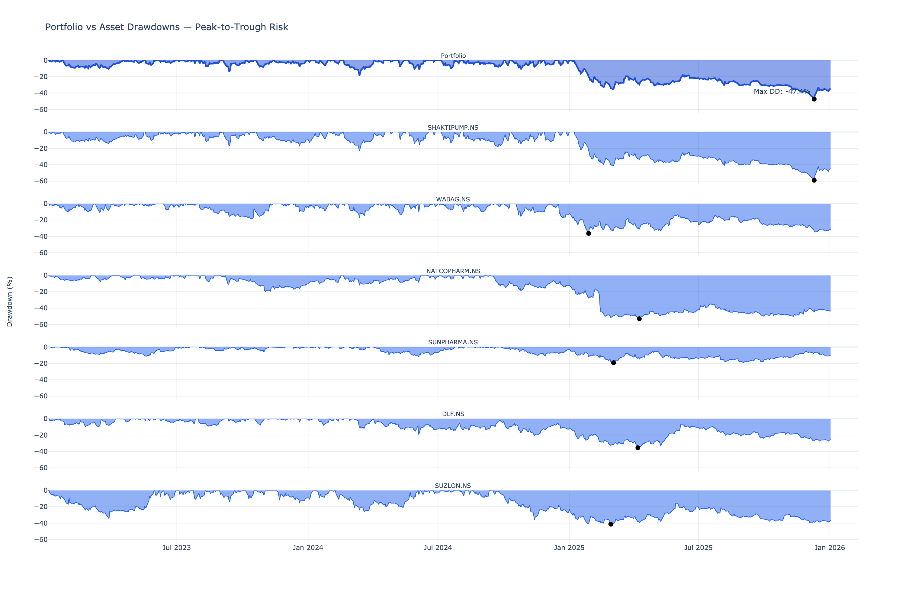
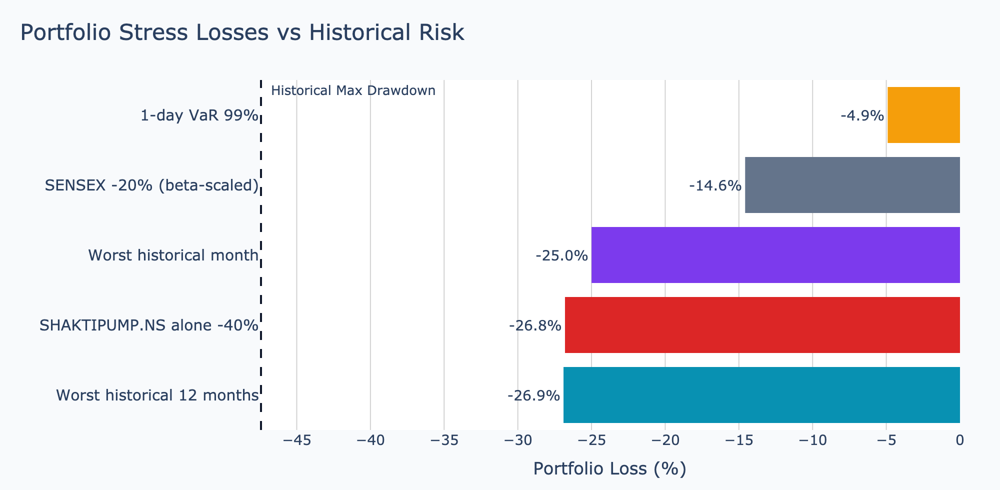
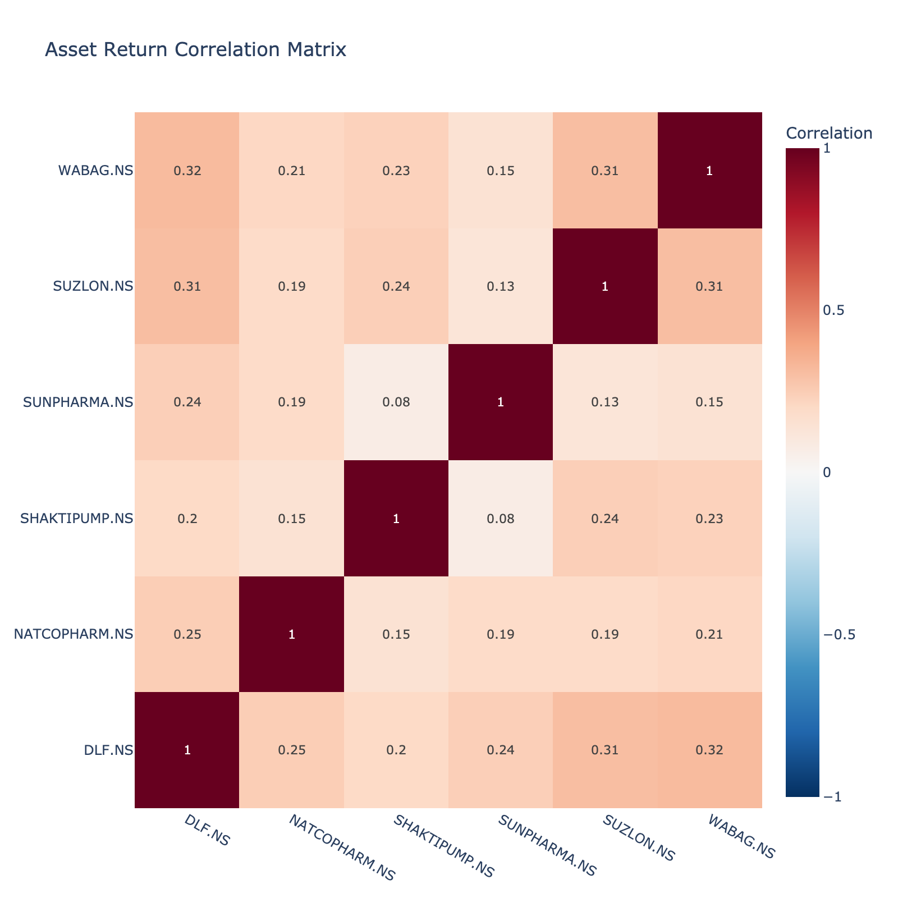
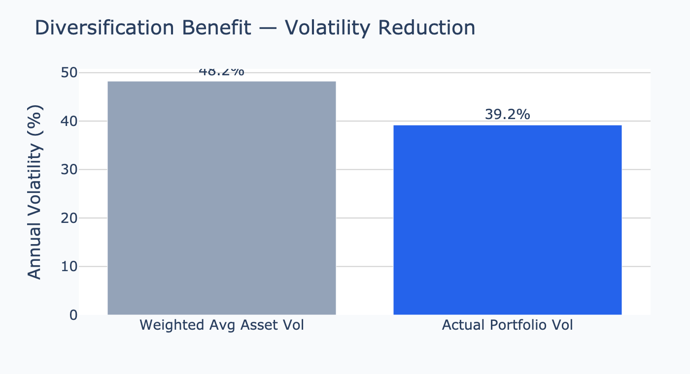

<h1 align="center">FinRisk-Lab</h1>

<p align="center">
  <strong>Portfolio risk & stress-testing in Python.</strong><br/>
  Quantifies downside, diversification failure, and concentration risk for a configurable portfolio — with every assumption made explicit.
</p>

<p align="center">
  
  
  
</p>

<p align="center">
  
</p>

---

## About this project

FinRisk-Lab is a personal project. The goal was to understand portfolio risk well enough to implement every metric from scratch — not to compete with mature libraries.

Established Python tools (`quantstats`, `riskfolio-lib`, `pyportfolioopt`) cover the same surface area more completely, with maintained APIs and a larger feature set. This repo is deliberately not trying to replicate them. It is a from-the-ground-up implementation with three constraints:
- **Every formula is in the code, not a risk-library call.** Sharpe, volatility, drawdown, beta, risk contribution, diversification benefit, VaR/CVaR — written out on top of plain pandas `std` / `cov` / `corr`.
- **Every assumption is documented**, in this README and the source.
- **Failures are loud, not silent** — invalid weights, a ticker with no data, a flat benchmark, or insufficient history raise.

If you want a production risk analytics tool, use `quantstats`. If you want to see what every number in a portfolio risk report actually means, read this repo.

---

## Who this is for

- Junior analysts or students building intuition for portfolio risk math.
- Anyone with a concentrated retail portfolio who wants to see exactly how much risk one position is carrying.
- Reviewers of this README (PM / quant interviewers): the artefact demonstrates the ability to define a problem precisely, implement a measurement system for it, and document the assumptions that constrain interpretation.

---

## The question this answers

> **"How bad can this portfolio get — and why?"**

Most retail and junior-analyst tooling focuses on returns. Volatility, when shown, is presented in isolation. What's typically missing:

- **Concentration risk** — how much of total risk does one position actually carry?
- **Diversification benefit** — what does weighted-average volatility imply, vs. what the portfolio actually delivers?
- **Stress behaviour** — what happens when correlations spike and diversification math breaks?

FinRisk-Lab makes these three questions answerable for any configured portfolio — including a real, mixed one: Indian and US stocks and ETFs, mutual funds, debt funds and cash, all analysed in INR. See [Analyse your own portfolio](#analyse-your-own-portfolio).

---

## Worked example — a deliberately concentrated portfolio

The default configuration in [`config/settings.py`](config/settings.py) is a 6-asset Indian equity portfolio chosen to expose concentration risk:

| Ticker | Weight |
|---|---:|
| SHAKTIPUMP.NS | 67% |
| WABAG.NS | 17% |
| NATCOPHARM.NS | 7% |
| DLF.NS | 3% |
| SUNPHARMA.NS | 3% |
| SUZLON.NS | 3% |

Date range: **Jan 2023 – Jan 2026**. Benchmark: **SENSEX (^BSESN)**.

Running `python -m src.main` against this portfolio produces the numbers below (full output is written to `outputs/results.json`). Yahoo re-adjusts historical prices for dividends, so a rerun can move these in the second decimal.

| Metric | Value | Interpretation |
|---|---:|---|
| Cumulative return | **+702%** | Over 3 years, holding the target weights (rebalanced daily, no costs) |
| CAGR | **100%** | Annualised over elapsed calendar time |
| Annual volatility | **39.2%** | Realised σ of the constant-weight portfolio |
| Sharpe ratio | **1.86** | Excess return over a 5.6% risk-free rate, per unit of volatility |
| Max drawdown (target weights) | **−47.4%** | Worst peak-to-trough if rebalanced back to target weights |
| Max drawdown (buy-and-hold) | **−55.5%** | Worst peak-to-trough if bought once and never rebalanced |
| 1-day VaR 99% / CVaR | **−4.9% / −5.4%** | Loss exceeded on 1 day in 100 / average loss on those days |
| Diversification benefit | **9.0 ppt** | Weighted-avg asset vol (48.2%) − actual portfolio vol (39.2%) |
| SENSEX −20% stress loss | **−14.6%** | Each asset falls β × 20%; understates risk here (see below) |
| SHAKTIPUMP −40% shock loss | **−26.8%** | Portfolio loss if the largest position alone falls 40% |
| Correlation-stress vol | **43.9%** | Annualised σ if every correlation moves halfway to +1 |
| Worst historical month / 12 months | **−25.0% / −26.9%** | Worst rolling 21-day / 252-day return actually observed |
| **SHAKTIPUMP risk contribution** | **88.1%** | Position holds 67% of weight but 88.1% of total portfolio risk |

The headline: a concentrated portfolio can post triple-digit annualised returns *and* expose the investor to a ~50% drawdown. The point of the engine is to make that asymmetry visible up front, not after the fact.

---

## What the analysis surfaces

### 1. Concentration risk — weight vs. risk contribution

The hero chart (top of README) plots portfolio weight against actual risk contribution. SHAKTIPUMP holds 67% of weight but carries **88.1%** of risk — a 21.1 ppt excess over its weight share, shown in red.

### 2. Drawdown reality — portfolio vs. each asset


The top panel is the drawdown of the portfolio held at its target weights (rebalanced daily). Per-asset panels below show that diversification softens — but does not eliminate — the pain when the dominant position drops. An investor who bought once and never rebalanced would have fared worse (−55.5%): the winner grows from 67% to about 90% of the basket, so its fall hurts more.

### 3. Stress scenarios — hypothetical shocks next to what actually happened


Each bar is a portfolio loss:
- **SENSEX −20% (beta-scaled)** — the index drops 20% and each asset falls by its beta. For this portfolio it is the *mildest* scenario: SHAKTIPUMP's beta is only 0.59, so the scenario ignores the stock-specific risk that dominates a 67% position.
- **SHAKTIPUMP alone −40%** — the single largest position falls 40%, everything else flat.
- **1-day VaR 99%** — the daily loss exceeded on only 1 day in 100 over the window.
- **Worst historical month / 12 months** — the worst rolling returns these weights actually produced.

The correlation stress is a volatility, not a loss, so it is reported in the table above rather than on this chart.

### 4. Correlation structure


Pairwise return correlations sit in the 0.08 – 0.32 range over this window. Diversification math holds in normal regimes — the stress engine exists because that math fails during real drawdowns.

### 5. Diversification benefit


Weighted-average asset volatility (48.2%) vs. actual portfolio volatility (39.2%). The 9.0 ppt gap is the diversification benefit — meaningful in normal conditions, vulnerable under stress.

---

## What this project is — and is not

**Is:**
- A portfolio risk analytics engine with modular, reusable metrics
- An explainable framework — every assumption is in the code or this README
- A stress-testing harness for "how bad can it get under specific scenarios"

**Is not:**
- A trading strategy or signal generator
- A return-prediction model
- A machine-learning system
- A maintained library (use `quantstats` / `riskfolio-lib` for production use)

---

## Methodology

### Risk metrics computed (per asset and portfolio)

| Metric | Module | Notes |
|---|---|---|
| Simple & log returns | [`src/metrics/returns.py`](src/metrics/returns.py) | All risk statistics use simple returns, so every ratio is internally consistent |
| Annualised volatility | [`src/metrics/volatility.py`](src/metrics/volatility.py) | σ × √252 (daily) or √52 (weekly) |
| Maximum drawdown | [`src/metrics/drawdown.py`](src/metrics/drawdown.py) | Peak-to-trough on adjusted prices / portfolio value |
| Correlation matrix | [`src/metrics/correlations.py`](src/metrics/correlations.py) | Pearson on returns |
| Sharpe ratio | [`src/metrics/sharpe.py`](src/metrics/sharpe.py) | Excess over the risk-free rate; not reported for zero-volatility assets |
| Beta vs benchmark | [`src/metrics/beta.py`](src/metrics/beta.py) | Covariance(asset, benchmark) / variance(benchmark) |
| VaR / CVaR | [`src/metrics/var.py`](src/metrics/var.py) | Historical simulation at 95% and 99%, no normality assumption |

### Portfolio aggregation

Portfolio risk is *not* a weighted average of asset risk. The engine explicitly models:

- Cumulative return: `(1 + r).prod() - 1` over the window
- CAGR: `(1 + cumulative_return)^(1 / n_years) − 1`, with `n_years` as elapsed calendar time
- Annualised portfolio volatility from the full covariance matrix (not a weighted average of σ)
- Risk contribution per asset (marginal contribution × weight, normalised to sum to 100%)
- Diversification benefit (weighted-avg asset σ − actual portfolio σ, in percentage points)
- Two value paths: constant weights (rebalanced every period) and buy-and-hold (never rebalanced)

A single-asset portfolio is rejected: correlation and diversification are undefined for one asset.

### Stress testing

Scenarios in [`src/risk_models/stress_engine.py`](src/risk_models/stress_engine.py), sized in [`config/settings.py`](config/settings.py):

1. **Benchmark shock** — the benchmark falls 20%; each asset loses `β × shock`. Portfolio loss is the weighted sum. This captures market risk only, not stock-specific risk.
2. **Single-asset shock** — each asset alone falls 40% (capped at 3× its own annual volatility, so a liquid fund or fixed deposit is not "crashed" by 40%), others flat. The chart reports the worst case.
3. **Correlation stress** — every correlation moves halfway toward +1 (`ρ' = ρ + 0.5·(1 − ρ)`) and portfolio σ is recomputed. This always raises risk and keeps the matrix valid.
4. **Worst historical windows** — the worst rolling week, month and 12 months the current weights actually produced.

The first three are deterministic "what if" scenarios, not probabilities. VaR/CVaR is the probabilistic complement.

---

## Architecture

```
config/settings.py  or  holdings.csv   ── what you hold
        │
        ▼
src/ingestion/      ── Yahoo Finance prices, mutual-fund NAVs (mfapi.in), cash; FX → INR
src/preprocessing/  ── one common calendar: forward-fill gaps, drop pre-listing rows
src/metrics/        ── returns, volatility, drawdown, correlations, sharpe, beta, VaR
src/portfolio/      ── aggregation + risk contribution + diversification benefit
src/risk_models/    ── stress scenarios
src/visualization/  ── Plotly charts
        │
        ▼
outputs/results.json            ── all numeric metrics (written before any chart)
outputs/<name>/report.html      ── holdings mode: one page with every table and chart
outputs/charts/*.png            ── static chart exports (via generate_charts.py)
```

Each layer is intentionally modular so metrics can be reused independently and failures occur early — invalid weights, a ticker with no data, or insufficient history raise rather than producing silent garbage.

---

## Assumptions & limitations

Deliberate constraints, not bugs:

- **Historical prices proxy future risk.** Volatility and correlations are backward-looking.
- **Today's weights, past prices.** Every figure applies the current weights to history. It describes the risk of the portfolio as it is now, not the returns an investor actually earned (which depend on when they bought).
- **No regime-switching.** The engine treats the entire window as a single regime.
- **VaR is historical simulation.** It cannot show a loss worse than anything in the window.
- **No transaction costs, taxes, or liquidity constraints** are modelled.
- **Risk-free rate** is a single constant in [`config/settings.py`](config/settings.py) (5.6%, India 91-day T-bill, Oct 2026); override with `--rf`.
- **Annualisation** uses 252 trading days (daily) or 52 weeks (weekly).
- **Single benchmark** for beta. The benchmark shock therefore says little about assets that do not move with it (gold, debt, foreign equity). Multi-factor beta is out of scope.
- **Volatility understates debt-fund risk.** Credit events and rate shocks are rare and barely show up in NAV volatility; a debt fund's high Sharpe ratio is not comparable to an equity fund's.
- **Yahoo indices are price-return**, while fund NAVs and adjusted prices include dividends.

---

## Scope status

Feature-complete for the analytical questions it was designed to answer. Possible extensions that are *intentionally out of scope* unless the project picks back up:

- Walk-forward backtesting and rolling stress
- Monte Carlo stress paths
- Multi-factor beta decomposition
- Transaction-level returns (XIRR) from broker statements
- A dashboard UI

---

## How to run

### Prerequisites
- Python 3.11+
- Internet access (`yfinance` fetches fresh data each run)

### 1. Clone & install
```bash
git clone https://github.com/Rhythmjain12/FinRisk-Lab.git
cd FinRisk-Lab
python -m venv venv && source venv/bin/activate
pip install -r requirements.txt
```

### 2. Configure your portfolio
Edit [`config/settings.py`](config/settings.py):
- `ASSETS` — Yahoo Finance tickers on one exchange (`RELIANCE.NS`, `TCS.NS`, etc.). For a mix of markets, funds and cash use a holdings file (below).
- `PORTFOLIO_WEIGHTS` — must sum to 1.0; keys must match `ASSETS`
- `START_DATE` / `END_DATE` — analysis window
- `RISK_FREE_RATE`, `BENCHMARK_TICKER`, stress-scenario sizes, etc.

### 3. Run the pipeline
```bash
python -m src.main
```
Numeric output → `outputs/results.json`. Interactive Plotly charts open in the browser.

### 4. (Optional) Export charts as static PNGs
```bash
pip install -r requirements-dev.txt
python generate_charts.py
```
`kaleido` is pinned to 0.2.1: newer releases hit a JSON-serialisation error on `pandas.Timestamp` axis values.

### 5. (Optional) Run the tests
```bash
pip install -r requirements-dev.txt
python -m pytest -q
```
The tests are offline (synthetic prices, stubbed downloads).

---

## Analyse your own portfolio

For a real portfolio that mixes stocks, ETFs, mutual funds, debt funds and cash across India and abroad:

```bash
cp holdings.example.csv holdings.csv      # then edit holdings.csv
python -m src.main --holdings holdings.csv
```

`holdings.csv` is git-ignored, so your holdings stay on your machine. One row per holding:

| Column | Meaning |
|---|---|
| `name` | Any unique label |
| `asset_class`, `region` | Free text used for roll-ups (Equity / Debt / Gold / Cash; India / International) |
| `source` | `yahoo` (stocks, ETFs — `RELIANCE.NS`, `NIFTYBEES.NS`, `AAPL`, `VOO`), `mf` (Indian mutual funds), or `cash` |
| `symbol` | Yahoo ticker, or the AMFI scheme code for `mf` |
| `currency` | Optional. The quote currency is read from Yahoo and converted to INR at the same-day rate; if you fill this in, it is cross-checked |
| `units` *or* `value_inr` | Units held, or the current value in INR (exactly one) |
| `annual_yield` | Cash / FD only, e.g. `0.07` |

Find a mutual fund's scheme code by name:
```bash
python -m src.main --find-fund "parag parikh flexi cap"
```
Use the exact plan you hold (Direct or Regular) and a **Growth** option — IDCW NAVs drop on every payout, which would be read as a loss.

Options: `--years 5` (history window; at least ~8 months of common history is required), `--rf 0.056` (risk-free rate), `--benchmark ^NSEI` (a foreign index is converted to INR).

The run stops with a named error, rather than guessing, when a symbol has no data, a typed currency does not match the quote, or a holding's prices stopped (a merged fund or delisted stock).

Output goes to `outputs/holdings/`: `report.html` (headline numbers, a per-holding table and every chart, including weight-vs-risk by asset class, region and currency), `results.json`, and `prices_inr.csv`.

How the mixed portfolio is handled:
- **One currency.** Every price is converted to INR before returns are computed, so currency moves are part of each foreign holding's risk.
- **One calendar.** Indian and US exchanges and mutual-fund NAVs publish on different days; prices are placed on an every-weekday calendar with gaps forward-filled, and the window starts when the youngest holding has a price (the run tells you which holding that is).
- **Weekly returns.** A US close and an Indian close on the same date are about ten hours apart, which pushes daily correlations toward zero and overstates diversification. Volatility, correlation, beta, Sharpe and VaR therefore use complete Friday-to-Friday weekly returns.
- **Cash** is a zero-volatility asset growing at its yield: it dilutes risk and has no Sharpe ratio.

---

## Web app

The same analysis runs in the browser, in [`web/`](web/): enter holdings, get the risk statement, download it as a PDF.

- **Nothing to install, nothing uploaded.** The risk engine is a TypeScript port of the Python one ([`web/src/engine/`](web/src/engine/)) and runs in your browser. Amounts never leave it; only search text, ticker symbols and fund codes are sent, to fetch prices.
- **Same numbers as the Python tool.** [`web/test/parity.test.ts`](web/test/parity.test.ts) runs both engines on the same prices and requires every metric to match to 1e-9. Regenerate the fixture with `venv/bin/python web/test/make_fixture.py` after changing the method.
- **Same holdings file.** Import and export use the `holdings.csv` format above.
- **PDF.** "Download PDF" opens the browser's print dialog with an A4 layout; choose "Save as PDF".

How it is hosted: one Cloudflare Worker serves the built site and answers `/api/*`, which relays Yahoo Finance's price and search endpoints (browsers cannot call them directly). Mutual-fund NAVs come straight from mfapi.in.

```bash
cd web
npm install
npm test             # engine parity with Python, panel builder, CSV
npm run preview      # build, then serve site + Worker at http://localhost:5179
```

For live reload while editing, run `npm run dev:api` and `npm run dev` in two terminals.

Deploy: connect this repository in the Cloudflare dashboard (Workers & Pages → Create → Import a repository) with root directory `web`, build command `npm run build` and deploy command `npx wrangler deploy`. Every push to `main` then deploys.

---

## Correctness notes

**2026-10-13 — methodology review.** A full audit ([`ANALYSIS_REPORT.md`](ANALYSIS_REPORT.md)) led to these changes; the worked-example numbers and charts above were regenerated afterwards.
- CAGR uses elapsed calendar time instead of `rows / 252` (103% → 100%).
- Portfolio volatility, risk contribution and Sharpe all use simple returns; previously log-return covariance was combined with arithmetic weights (38.4% → 39.2%).
- Risk-free rate is 5.6% instead of 0, and Sharpe is no longer overstated.
- The correlation stress moves correlations toward +1 instead of multiplying them by 1.5, which could *reduce* risk for negatively correlated assets (39.6% → 43.9%).
- The stress chart shows losses only; a volatility used to be plotted as a loss.
- Prices are aligned to one calendar and a ticker with no data raises, instead of missing days silently counting as 0% returns.
- Added: VaR/CVaR, buy-and-hold drawdown, worst historical windows, portfolio Sharpe and beta, and the holdings-file mode.

**2026-07-06 — alignment bug.** Portfolio volatility and risk contribution fed weights into a positional `np.dot` against an alphabetically-sorted covariance matrix, so each weight was applied to the wrong asset. Weights are now reindexed to the matrix's column order first; `test_alignment.py` pins the behaviour. Effect on the default portfolio: annual volatility 24.4% → 38.4%.

---

## License

MIT.

© 2026 Rhythm Jain.
